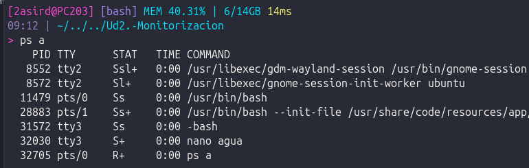
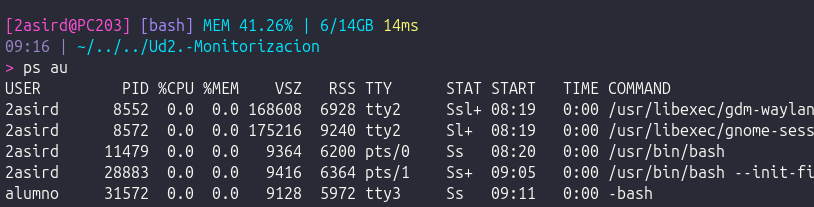
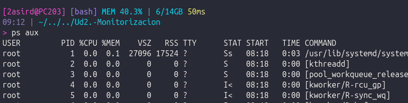
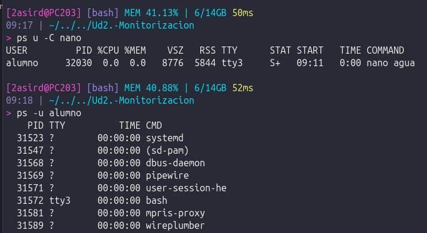
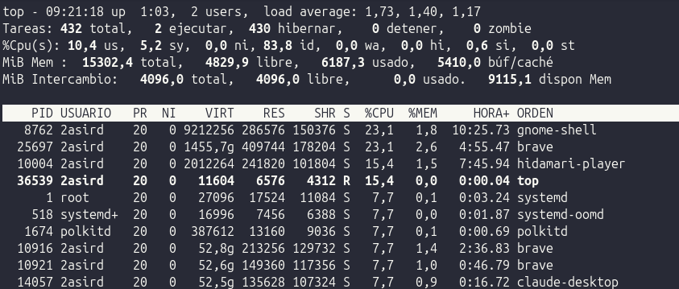
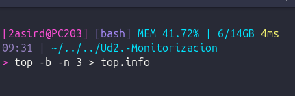
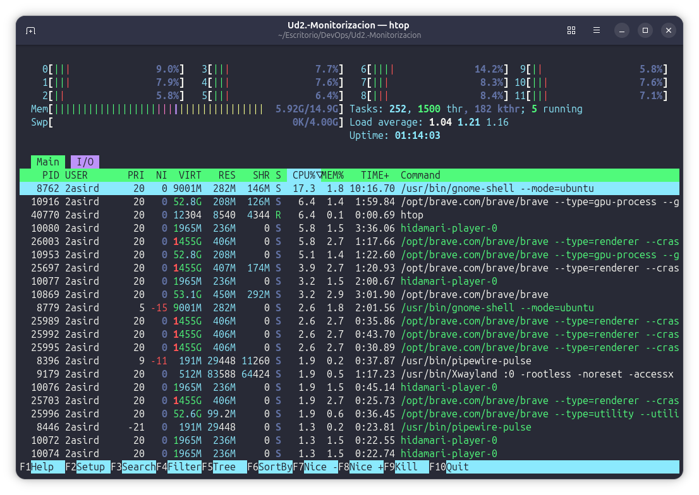
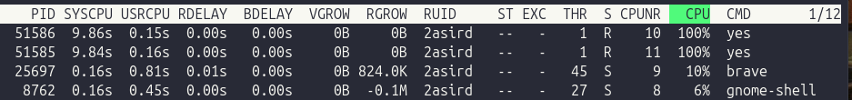
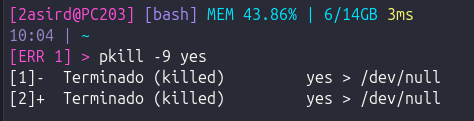
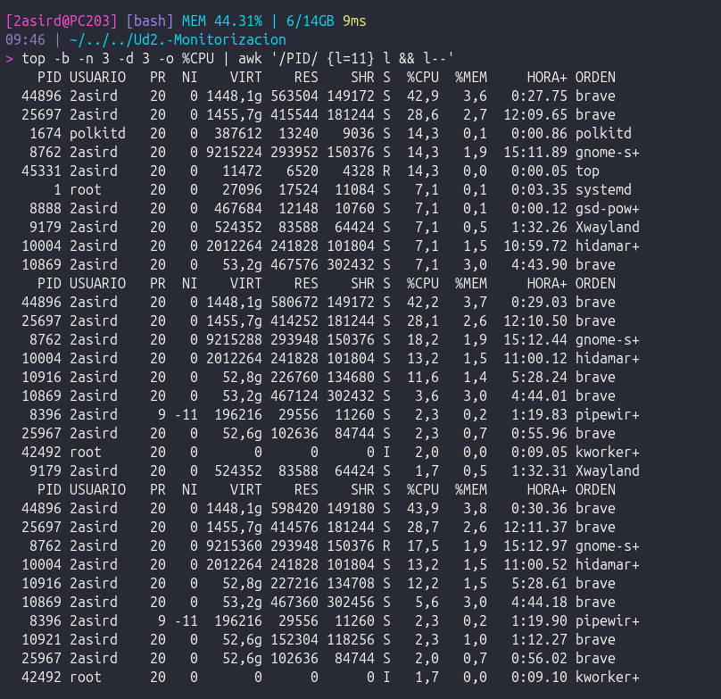

# Procesos

En Linux, cada proceso en ejecución tiene un identificador (**PID**) y un estado.
Los comandos `ps` y `top` permiten consultar los procesos y su actividad.

## Consultar procesos con `ps`

`ps` muestra una instantánea de los procesos en el momento de ejecutar el comando.
Estas variantes usan la sintaxis BSD de `ps`:

| Comando | Qué muestra |
| --- | --- |
| `ps a` | Procesos asociados a una terminal. |
| `ps au` | Procesos asociados a una terminal con un formato orientado al usuario. |
| `ps aux` | Procesos de todos los usuarios, incluidos los que no tienen terminal. |

En la columna `STAT`, algunos estados habituales son:

| Estado | Significado |
| --- | --- |
| `R` | En ejecución o listo para ejecutarse (*running/runnable*). |
| `S` | En espera interrumpible (*interruptible sleep*). |

### Ejemplos

`ps a` muestra procesos asociados a terminales:



`ps au` añade columnas como el usuario y el porcentaje de CPU y memoria:



`ps aux` también incluye procesos sin terminal, como servicios del sistema:



Se puede filtrar la consulta por nombre de comando o usuario:

```bash
ps u -C nano
ps -u alumno
```



## Supervisar procesos con `top`

`top` actualiza continuamente la información de procesos y del uso de recursos.
Pulsa estas teclas mientras está abierto para ordenar la lista:

| Tecla | Orden |
| --- | --- |
| `M` | Por porcentaje de memoria (`%MEM`). |
| `P` | Por porcentaje de CPU (`%CPU`). |
| `T` | Por tiempo acumulado de CPU (`TIME+`). |
| `N` | Por identificador de proceso (`PID`). |
| `R` | Invierte el sentido del orden actual. |



### Guardar la salida de `top`

El modo por lotes (`-b`) permite ejecutar `top` sin la interfaz interactiva.
Con `-n 3` se recopilan tres actualizaciones y `>` guarda la salida en `top.info`
(si el archivo ya existe, se sobrescribe):

```bash
top -b -n 3 > top.info
```



## Monitor interactivo con `htop`

`htop` es un monitor interactivo de procesos. Muestra indicadores de CPU y
memoria, información de tareas y una lista de procesos. Las teclas de función
permiten acceder a acciones como buscar, filtrar y ordenar la lista.



## Monitor de recursos con `atop`

`atop` muestra en una interfaz interactiva el uso de recursos del sistema y la
actividad de los procesos. Inícialo con:

```bash
atop
```

La vista de procesos permite consultar, entre otros datos, el consumo de CPU y
la actividad de cada proceso:



### Terminar procesos por nombre con `pkill`

`pkill` busca procesos por nombre y les envía una señal. Por ejemplo:

```bash
pkill -9 yes
```

`-9` envía `SIGKILL`, que termina el proceso inmediatamente y no le permite
cerrarse de forma ordenada. Úsalo solo cuando sea necesario: si un proceso
guarda datos o realiza una tarea, puede perderse ese trabajo. Normalmente es
preferible intentar primero `pkill yes`, que envía `SIGTERM` y permite al
proceso finalizar limpiamente.



## Ejercicio: guardar los procesos con mayor consumo de CPU

Recopila los **10 procesos que más CPU consumen** en cada una de **3 muestras
consecutivas**, separadas por 3 segundos, y envía el resultado al equipo del
proyecto. El siguiente comando ordena los procesos por CPU, selecciona las diez
primeras filas de cada muestra y guarda la salida en el equipo remoto:

```bash
top -b -n 3 -d 3 -o %CPU \
  | awk '/PID/ {l=11} l && l--' \
  | ssh usuario@IP_PC_PROYECTO "cat > /ruta/destino/top_10_cpu.txt"
```



### ¿Qué hace cada opción?

| Fragmento | Función |
| --- | --- |
| `top` | Muestra información de procesos y del sistema. |
| `-b` | Ejecuta `top` en modo por lotes, adecuado para procesar su salida. |
| `-n 3` | Genera tres muestras y termina. |
| `-d 3` | Espera 3 segundos entre muestras. |
| `-o %CPU` | Ordena la lista por uso de CPU, de mayor a menor. |
| `awk '/PID/ {l=11} l && l--'` | Detecta cada cabecera `PID` y muestra esa cabecera junto con las diez filas siguientes. Así selecciona diez procesos por muestra. |
| `ssh usuario@IP_PC_PROYECTO` | Conecta por SSH al equipo remoto. Sustituye `usuario` y `IP_PC_PROYECTO` por los datos reales del equipo. |
| `cat > /ruta/destino/top_10_cpu.txt` | Escribe en ese archivo remoto todo lo recibido. Sustituye la ruta por una carpeta existente y escribible. Si el archivo ya existe, se sobrescribe. |

El archivo resultante contiene hasta **30 filas de procesos** (10 por muestra),
además de una cabecera para cada muestra. Para ejecutarlo, necesitas poder
conectarte por SSH al equipo remoto y tener permisos de escritura en la ruta de
destino.